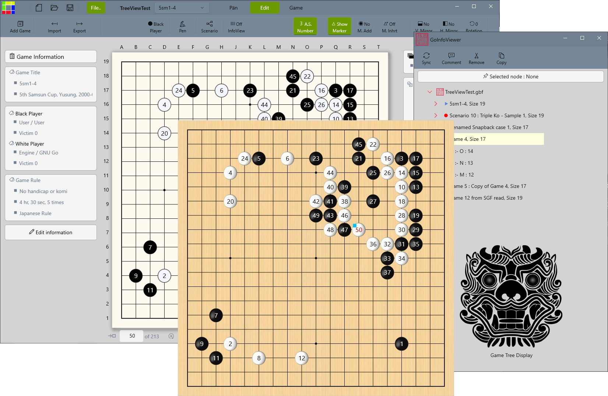

## View, edit and play of Go game
 

           
### Description
Provide various board sizes, and play game with Go engine.   
Board size available from 9x9 to 19x19, 21x21 for experiment.   
Support SGF file read and write.   
Play game with GNU Go or Leela Zero LITE weight version.  
Go puzzle(a.k.a Tsmego) creation and play 
InfoCenter provides learning links of videos and Go files.

Note: User's manual is in InfoCenter. Install the app and go to 'InfoCenter' from the menu. Or, you may click the right button on a function key or on the region of screen, that will show up the option list when available.

Download Sample file :  
 
<a href="Sample_GBF_1_File.gbf">Sample_GBF_1_File.gbf</a>
 This is provided to show types of games and to check out the performance with some exceptional cases such as supr Ko.

<a href="Go puzzle creation sample.gbf">Go puzzle creation sample.gbf</a>
 This shows the steps to create Go puzzle, and the final sample for examination.

### Installation
OS : Windows 10+  
The App is downloadable from Microsoft App Store.   
The app is installed with external Go engine  as listed below:   
1. GNU Go version 3.8
2. Leela Zero version 0.17 

### Contact
Bug, comment or suggestion? Welcome to send me an email to jkadreamer at gmail dot com or moldlab at hotmail dot com.

[Link to Privacy page](Privacy/privacy.md).

